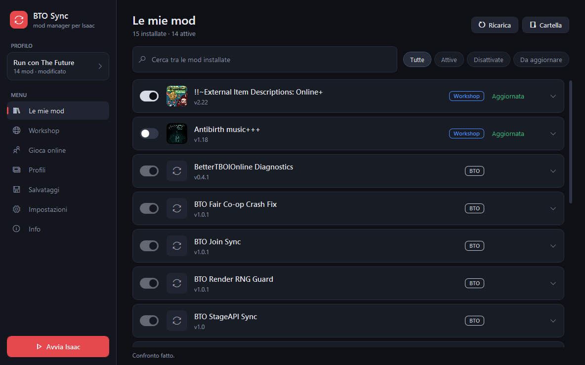
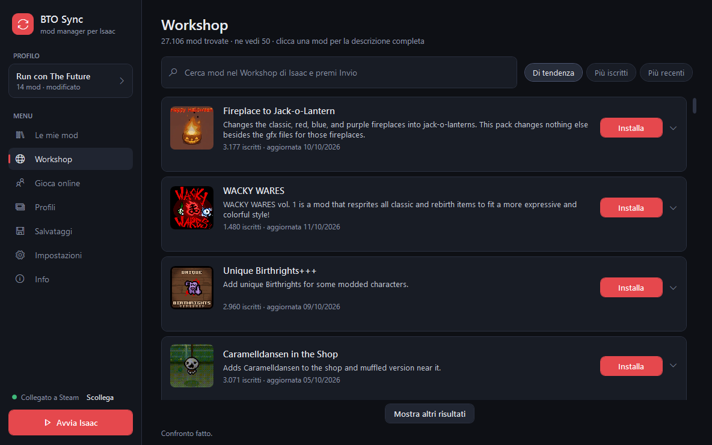
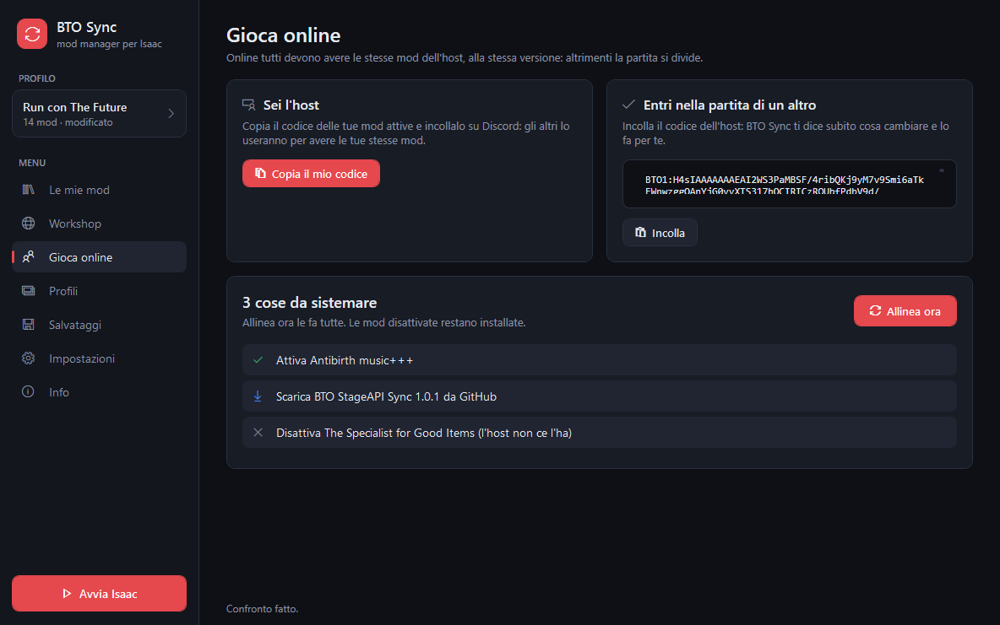
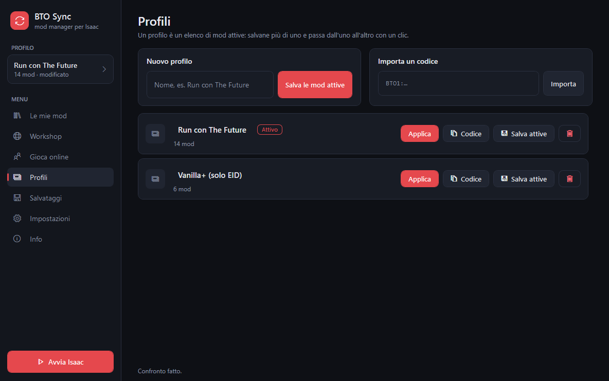
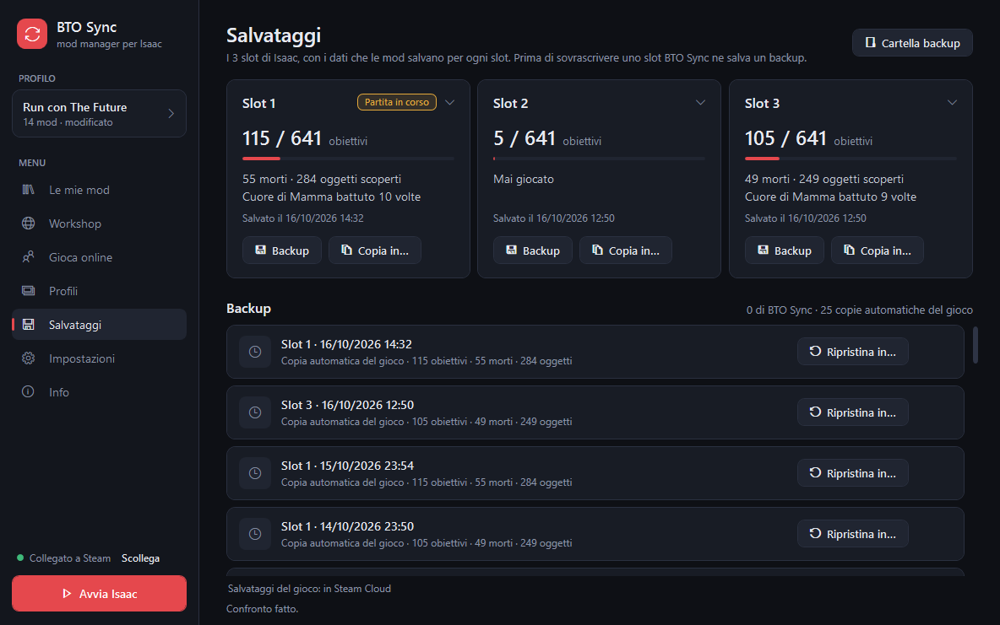
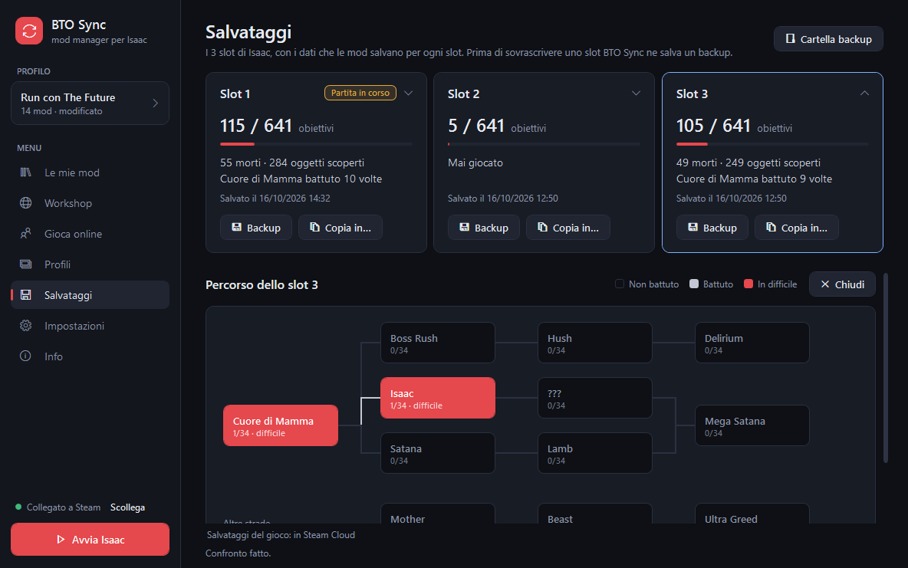
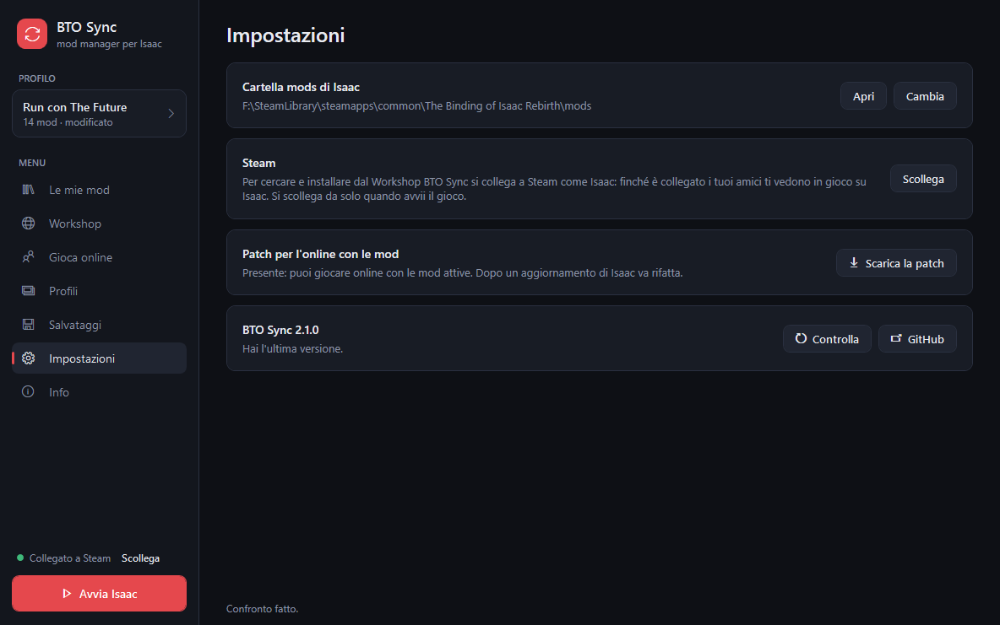

# BetterTBOIOnline

Giocare online con gli amici a *The Binding of Isaac: Repentance+* (Steam, Windows) **con le mod
attive**, senza che la partita si divida.

Online Isaac funziona in lockstep: ogni PC simula la stessa partita e basta una differenza minima
(una mod in più, una versione diversa, un numero casuale pescato in un momento diverso) perché la
partita si "sdoppi" (desync). Questo progetto ha due parti:

- **BTO Sync**, un programma per Windows che mette le mod di tutti in pari con quelle dell'host,
  con un clic;
- **le mod BTO**, piccoli fix che tolgono le cause di desync e crash trovate nei log delle nostre
  partite, nel gioco base e in mod del Workshop come The Future, StageAPI e Fair Co-op Items.

Le mod BTO non si installano a mano: le installa e le aggiorna BTO Sync.

## Scaricalo

1. Vai nelle [release](https://github.com/MICHELOSCO/BetterTBOIOnline/releases) e scarica
   `BTO-Sync-X.Y.Z.zip` dall'ultima release `sync-v…`.
2. Estrailo dove vuoi e apri `BTO-Sync.exe`, **a gioco chiuso** e con Steam aperto. Non serve
   installare nulla.
3. Se Windows dice "PC protetto": "Ulteriori informazioni" › "Esegui comunque". Succede perché
   l'exe non ha una firma digitale: [perché è sicuro](docs/BTO-Sync.md#perché-è-sicuro).

Si aggiorna da solo: all'avvio guarda se qui c'è una versione nuova e la installa se premi
"Aggiorna ora".

## Cosa fa

### Le mie mod
Tutte le mod installate, con l'interruttore per attivarle o disattivarle (disattivare non cancella
nulla), la ricerca, i filtri e "Aggiorna" per le mod del Workshop vecchie. Cliccando una mod se ne
legge la descrizione. Le mod BTO hanno l'interruttore bloccato: le gestisce BTO Sync insieme alla
mod che sistemano.

### Workshop
Cerca nel Workshop di Steam per nome, oppure sfoglia per tendenza, iscritti o novità. "Installa" ti
iscrive, scarica la mod e la mette già attiva.

### Gioca online
Il cuore del programma. L'host preme "Copia il mio codice" e lo incolla su Discord: è un codice
`BTO1:` con l'elenco delle sue mod. Gli altri lo incollano qui, e BTO Sync mostra cosa va attivato,
disattivato o scaricato. "Allinea ora" fa tutto, poi "Avvia Isaac".

### Profili
Elenchi di mod attive da salvare e richiamare, per esempio "Run con The Future" e "Vanilla+".
Un profilo si può anche mandare agli amici come codice.

### Salvataggi
I 3 slot di Isaac con obiettivi, morti e oggetti scoperti. Puoi fare un backup, copiare uno slot in
un altro e ripristinare, anche dalle copie che il gioco fa da solo ogni giorno. Prima di
sovrascrivere uno slot BTO Sync ne fa sempre un backup. Cliccando uno slot si vede il suo percorso:
i boss finali battuti e con quali personaggi.

### Impostazioni e Info
La cartella del gioco, Steam, gli aggiornamenti e il controllo della **patch per l'online**: Isaac
fa entrare online solo con le mod spente, a meno che il suo exe non sia patchato. BTO Sync controlla
se la patch c'è e, se manca, propone di scaricare
[Isaac-Online-Modded](https://github.com/xADDBx/Isaac-Online-Modded), che la applica.
La pagina Info riassume come funziona il programma e perché è sicuro.

## Come funziona e perché è sicuro

In breve:
- il codice è tutto in [`sync/`](sync);
- non chiede password o account e non manda dati a nessuno;
- parla solo con GitHub, con l'API pubblica di Steam e con il tuo client Steam;
- non modifica l'exe del gioco.

Tutti i dettagli sono in [docs/BTO-Sync.md](docs/BTO-Sync.md).

## Le mod BTO

| Mod | Cosa sistema | Attiva con |
|---|---|---|
| BTO Trinket Sync | Raccogliere o scambiare un trinket divideva la partita | sempre |
| BTO Treasure Jingle Sync | Una mod che riavvia la musica nella stanza del tesoro causava un desync | sempre |
| BTO Render RNG Guard | I numeri casuali usati mentre si disegna lo schermo (dipendono dagli fps) toccavano quelli sincronizzati | sempre |
| BTO Join Sync | Rientro in una run già iniziata dopo uno split (sperimentale) | sempre |
| BTO StageAPI Sync | Piani personalizzati di StageAPI senza desync | StageAPI |
| BTO The Future Sync | Nemici di The Future che sparano anelli di proiettili | The Future |
| BTO The Future Revive Fix | La Revive Machine dentro The Future bloccava tutti | The Future |
| BTO Fair Co-op Crash Fix | Crash di tutti insieme subito dopo uno split | Fair Co-op Items |
| BetterTBOIOnline Diagnostics | Solo log, per analizzare i desync (non cambia il gioco) | sempre |

Tutti devono avere le stesse mod BTO alla stessa versione: le mod se ne accorgono da sole all'inizio
della run, e BTO Sync le tiene in pari.

## Sviluppo

Struttura del repo, mod diagnostica e protocollo dei test: [docs/sviluppo.md](docs/sviluppo.md).
Analisi dei desync: [docs/findings.md](docs/findings.md).
